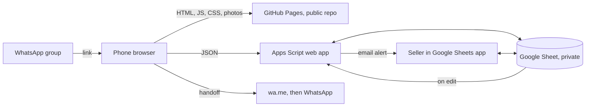

# A44 Medley Garage Sale: Build Brief

| | |
|---|---|
| **Owner** | The seller (product owner, approves every human gate) |
| **Audience** | Project manager agent, TDD dev agents, QA agent |
| **Version** | 2.4, 3 Nov 2026. Replaces earlier versions entirely. Discard any work based on v1 |
| **Approach** | MVP first, then small iterations driven by real use |
| **Data snapshot** | "A44 Medley Garage Sale" Google Sheet, read 3 Nov 2026 |

---

## 1. Pod kickoff

### 1.1 Prompt to paste into the PM agent

> Read `BUILD_BRIEF.md` in full. You are the project manager. Set up the repo docs in Section 11.1 without changing the brief's meaning. Build only the MVP in Section 8. Work through its slices in order, and don't start the post-MVP backlog unless the seller asks. Follow the working agreement in Section 11. You are also the seller's guide: before every step she must do, explain it in the format in Section 11.7. Stop at each human gate in Section 10. Never touch her real sheet, or use real buyer data, before Gate G2. If the brief is ambiguous, take the smaller option, record it as a proposed decision, and continue unless it hits a stop condition in Section 11.5.

### 1.2 Order of authority

1. The seller's latest instruction
2. Decision log (Section 5)
3. Story acceptance criteria (Section 8)
4. Rest of this brief

### 1.3 PM's first steps

1. **Start with setup, not code.** Walk the seller through Gate G0 first: creating the public GitHub repo, then connecting the build copy of the sheet. Use the Section 11.7 format for each step.
2. **Keep the build copy's link out of the repo.** The repo is public. Ask the seller for the link only when it's needed, and never put it in committed files. Until the scrub in S-03 has run and the seller has checked it by eye, the copy still holds neighbours' names and her number, so no agent may read its data or use it for anything except running the scrub.
3. **Never build ahead of explaining, or ask for secrets in chat.** Don't start building before explaining what's needed from the seller. Never ask her to paste a password or token into the chat. If she points out either has happened, stop, reread Section 11.7 and correct course.

---

## 2. Product

### 2.1 Problem

The sale runs on a Google Sheet shared in the residents' WhatsApp group. Neighbours comment on a row to claim an item, and the seller updates the status and name by hand. There's no waitlist and no easy way to back out, sold rows are hidden by hand, and the sheet is awkward on a phone.

### 2.2 MVP goal

A very light, mobile-first page where a neighbour can open a link, reserve items in under a minute, and back out without awkwardness, with the next person moving up automatically. The seller records sales with one dropdown and keeps a record of who bought what.

### 2.3 Users

- **Neighbour:** on a phone, arriving from a WhatsApp group link, possibly on poor mobile data. Won't create an account.
- **Seller:** on a phone, between packing tasks. Already comfortable with the Google Sheet.

### 2.4 MVP success measures

| Measure | Target |
|---|---|
| Open link to saved reservation, one item | Under 60 seconds |
| Seller's work to record a sale | One dropdown change, plus the price if negotiated |
| Back-out to next person becoming holder | Immediate |
| Page weight (HTML, CSS, JS, compressed, excluding photos and API data) | 50 KB or less |
| Who bought what | Complete in the `Sold` tab |

### 2.5 Scope

**MVP:** catalogue with quantities, category filter and search, multi-item reservation, ordered waitlist, self-service back-out, WhatsApp handoff, seller workflow in the sheet, email alert to the seller, photos.

**Not in the MVP:** see the post-MVP backlog in Section 9.

**Not planned:** online payment, buyer accounts or OTP, automatic WhatsApp sends, delivery, in-site chat, multi-seller support, real-device test matrix.

### 2.6 Core concepts

- **Item:** one row in the sheet, with a `Quantity`. A set sold whole is one item with quantity 1, for example "Mini jars, set of 6". Identical things sold separately are one item with a higher quantity, for example "Picture frame", quantity 4.
- **Claim:** one person's place in line for **one unit** of an item. Someone wanting 2 frames has 2 claims.
- **Booking:** one form submission, with a name, number, private link and one or more claims.
- **Holder:** a claim within the units still available. Later claims are **waiting**.

### 2.7 Journeys

**Reserve**
1. Open the link from the WhatsApp group.
2. Filter or search, and tap **Add** on items. Choose how many if the quantity is more than 1.
3. Tap the sticky **Reserve (3)** bar and enter name and WhatsApp number.
4. The booking saves. The confirmation shows what's held and what's waitlisted.
5. WhatsApp opens with the message written. The neighbour taps send.

**Back out**
1. Open the private link from the WhatsApp message or the saved link on the device.
2. Tap **Back out** on an item and confirm.
3. The next person becomes holder. The seller gets an email and a row in the `To do` tab.

**Sell**
1. In the Google Sheets app, open `Claims` and set a row's `State` to `sold`.
2. Change the sold price if it was negotiated.
3. The unit leaves the public count, and the sale appears in `Sold`.

### 2.8 WhatsApp message

```text
Hi! I'm Asha.

Reserved for me:
• Yoga Mat, KIMJALY (₹1,000)
• Picture frame × 2 (₹200 each)

On the waiting list:
• Echo Dot (2nd in line)

Change or back out: https://…/#/b/<token>
```

The seller's name isn't shown anywhere on the site or in messages.

---

## 3. Sheet audit findings

| Finding | Evidence | Consequence |
|---|---|---|
| Book buyers will want several items | 40 of 65 rows are books | One form and one message for many items |
| Sets and duplicates are coming | The seller plans picture frames, bookends, mini jars and similar. These aren't in the sheet yet | `Quantity` column, and the Template tab must include it |
| Existing duplicates don't need merging | The 2 yoga mats and 2 laptop stands are visibly different colours. The 2 tripods and 3 CCTV cameras are all already reserved or sold | Existing rows stay as quantity 1 |
| Comments are claims, and are already transcribed | The reservation comments are on Reserved rows that already have the name in `Person`. The seller confirmed the stray comment data on the first Books row is not a reservation, and that book is Available | Migrate from `Status` and `Person`. No comment parsing |
| Books have no photos | 0 of 40 book rows. All 25 other rows have images, 31 in total | Text-only rows must look intentional |
| Photos are plain phone shots | On floors and newspaper. 29 of 31 are portrait, about 190 KB on average | Small square thumbnails, full photo one tap away |
| Buyer names shouldn't be public | The sheet shows names next to items, and titles include sexual-health books | Public site never shows names |
| Some prices are blank | 1 book (*Free Fall*) | Displays as "Ask" |
| Pickup dates | 61 "Now". 4 books are real date cells, 2 Dec 2026 | See D-006 |

**Snapshot counts:** 65 rows (Tech 16, Gym & Sport 8, Home Things 1, Books 40). 55 Available, 7 Reserved, 3 Sold. 31 photos, 24 product links.

---

## 4. Architecture



### 4.1 Sheet structure

Existing tabs and columns stay where they are, so the sheet stays familiar. Add columns at the end.

| Tab | Change | Visible to public? |
|---|---|---|
| Tech, Gym & Sport, Home Things, Books | Add `K: ID` and `L: Quantity`. `Status` and `Person` become script-written and carry a protection warning | Only safe fields, through the API |
| Template | Add the same two columns | No |
| `Claims` (new) | Claim ID, Booking ID, Item ID, Item, Name, Number, State, Created, Promoted at, Notified, Sold price, Sold at, Ended at, Message link | Never |
| `Bookings` (new) | Booking ID, Token, Name, Number, Created, Idempotency key, WhatsApp opened | Never |
| `To do` (new) | `FILTER` of holders promoted and not yet notified | Never |
| `Sold` (new) | `FILTER` of sold claims, with totals | Never |

Books show **book name first, then author**, everywhere on the site and in messages. The seller may swap the Books columns to match, so code finds columns by header name, never by position. `Author` and the book name column are mapped by header. Other tabs use `Item` and `Brand`. Product links come from the rich-text link on the brand or book name cell.

### 4.2 Secrets and config

- **Script Properties, never in the repo:** `SELLER_WHATSAPP`, `SITE_URL`.
- **Public in the repo:** the API URL. This is unavoidable and acceptable, because the API exposes only safe data and a caller's own booking.
- **Staging:** the seller's private build copy of the sheet, with its own script deployment. Agents use only this. It starts with real names and the seller's number in it, so S-03 must scrub it first. Its link is never committed.
- **Real sheet:** stays public and in daily use for selling until cutover. Nothing about it changes during the build.

### 4.3 API

All responses are JSON. POST bodies are sent as `text/plain` to avoid a CORS preflight.

| Call | Purpose | Returns |
|---|---|---|
| `GET ?action=catalogue` | Public list | Item fields, `unitsLeft`, `waitingCount`, photo count. Never names or numbers. Excludes sold-out items. Short server cache, cleared on any write |
| `POST {action:"reserve"}` | Create booking | Token, per-unit outcome, skipped items, WhatsApp URL |
| `POST {action:"booking", token}` | Read own booking | Claims with positions, WhatsApp URL |
| `POST {action:"backOut", token, claimId}` | Back out or leave waitlist | Updated booking, WhatsApp URL for telling the seller |
| `POST {action:"waOpened", token}` | Record handoff | OK |

Tokens are sent in POST bodies, not query strings, so they don't land in Google's URL logs.

### 4.4 Site routing

One static page with hash routes: `#/`, `#/i/<id>`, `#/reserve`, `#/b/<token>`. A token in the URL fragment isn't sent to GitHub. Use `<meta name="referrer" content="no-referrer">`, `<meta name="robots" content="noindex">` and a CSP meta tag, because GitHub Pages doesn't allow custom headers.

---

## 5. Decision log

Only the seller can change an accepted decision. New decisions are recorded in `docs/decisions/`.

### D-001: GitHub Pages for the site, Apps Script and the Google Sheet for data

- **Context:** the seller wants GitHub hosting. GitHub Pages only serves static files, so reservations must be stored elsewhere, and something must prevent two people claiming the same unit.
- **Options for data:**
  - *Apps Script on the existing sheet:* free, no new account, and the seller keeps a familiar tool. Slower responses.
  - *Supabase:* a stronger database, but a new account, and free projects can pause after 7 days of low activity.
  - *GitHub itself (Issues or files):* would need a write token in public code, or expose names and numbers.
- **Decision:** Apps Script on the existing sheet. It also removes the need for an admin UI in the MVP.
- **Consequences:**
  - Expect API calls to take a noticeable moment, so the UI must show progress and cache the catalogue. Real timings are measured in S-04.
  - GitHub Free only allows Pages on **public repos**, so nothing personal may ever be committed.
  - GitHub Pages rules bar using it free as an online business or e-commerce site, and bar collecting passwords or card numbers. This one-off neighbourhood sale has no payments or passwords, which looks reasonable, but it's the seller's call and not a legal opinion. If it ever became a problem, the static files can move to another host without code changes.

### D-002: Vanilla TypeScript with no client framework

Small bundle via esbuild. No SSR, so the site needs JS to work. Accepted, since the whole app depends on live data.

### D-003: The sheet remains the source of truth

No migration away from the sheet. The seller's admin is the Google Sheets app for the MVP. Editing price or details in the item tabs appears on the site after the short cache expires.

### D-004: Quantity on items, with one claim per unit

- **Decision:** each item has a `Quantity` (default 1). Each claim is exactly one unit. Choosing 3 creates 3 claims.
- **Why:** partial outcomes work naturally (2 held, 1 waiting), and backing out of one unit needs no special handling.
- **Set rule:** the seller chooses per row. Sold whole means quantity 1 with "set of N" in the name. Sold separately means quantity N.

### D-005: No accounts. A private link identifies a booking

- **Decision:** each booking gets a random token of at least 128 bits. The browser also remembers its bookings in `localStorage`.
- **Rejected:** lookup by phone number, because anyone could type a neighbour's number and see or cancel their reservations.
- **Consequence:** numbers aren't verified. Fake entries are possible, and the seller can release them.

### D-006: "Available from" is the earliest pickup date

- **Decision:** "Now" displays as **Pick up anytime**. A date displays as **Pick up from 2 Dec**, because the seller is using the item until then. Items can be reserved now either way.
- **Consequence:** there's no overall sale closing date in the MVP, and no time limit on holds.

### D-007: Text-first list, photos in a supporting role

Single-column rows. 72 px square thumbnail where a photo exists. Books use a text-only row with no placeholder. No banners, hero images or photo grids.

### D-008: Save first, then WhatsApp

- **Decision:** after the save succeeds, set the booking page as the current route, then navigate the same tab to the `wa.me` URL. A **Send on WhatsApp** button is always on the booking page.
- **Why:** popups opened after an async step are commonly blocked, and saving first means a failed handoff can't lose a reservation.
- **Consequence:** the neighbour must tap send, and the site can't tell if they did. The reservation stands regardless. The seller has ruled out a device test matrix, and the button is the safeguard if the automatic jump doesn't fire on a phone.

### D-009: Public pages never show buyer identity

Only "Reserved" and the waiting count. Names and numbers exist only in the private sheet and on the buyer's own booking page.

### D-010: Holds don't expire automatically in the MVP

A hold lasts until the buyer backs out or the seller releases or sells it. The site can't message people, so silently ending a hold would be unfair.

### D-011: Number and sheet stay private

- The seller's number never appears in the repo, page source or catalogue. It reaches a browser only inside a WhatsApp URL returned after a reservation.
- **The sheet must stop being shared publicly at cutover**, because `Claims` and `Bookings` hold names and numbers. This is a launch blocker.

### D-012: Site title

"A44 Medley Garage Sale". No seller name. The title and house number will be in a public repo and on an unlisted page, by the seller's choice.

### D-013: Email alert to the seller

The script emails the sheet owner a summary of new reservations and back-outs, using the account's own address, so no address is stored in the code. Added because a neighbour might not tap send on WhatsApp. The seller doesn't want to be spammed, so there's at most one summary email an hour, and none if nothing happened. A better system can replace this after launch (N-10).

### D-015: Live connection between the site and sheet, not periodic two-way sync

- **Context:** the seller asked whether the sheet could stay the source of truth, with a frontend copy and periodic updates in both directions.
- **Decision:** the sheet is the source of truth, and reservations reach it immediately. Periodic sync of reservations is rejected. A periodic read-only copy of the item list stays available as N-05.
- **Agreed path:** launch with the live connection. Move to the N-05 copy only if real use shows browsing is too slow. Avoid a separate database with two-way sync, unless the seller later wants it purely as a learning experiment (N-11).
- **Why:** a static site has no shared memory, so reservations waiting for a sync aren't visible to other phones. Two neighbours could both be told they got the same item. Fixing that needs a separate database and conflict handling.

### D-014: Minimal personal data

Collect only name and number, with a short notice on the form. A post-MVP story clears them after the sale. This is good practice, not legal advice.

---

## 6. Rules

### 6.1 Queue

For each item, `unitsLeft = quantity − sold claims`.

1. Line order is the numeric Claim ID among `active` claims. IDs are never reused.
2. The first `unitsLeft` active claims are holders. The rest are waiting.
3. All holder and promotion data is recalculated from these rules by one function after any change. It stamps `Promoted at` on newly promoted claims and clears it from any claim that's no longer a holder.
4. Changing a `released` or `sold` claim back to `active` returns it to its original place, since its ID hasn't changed.
5. Someone who backs out and returns joins the end of the line.
6. All writes run inside `LockService.getScriptLock()`.
7. The seller may mark any active claim as sold, including a waiting one. If that would exceed the quantity, the edit is reverted with a cell note explaining why.
8. When an item is sold out, its waiters' claims stay `active`, so an undo can restore them. Their booking page says "This item was sold".

### 6.2 Public display

| Condition | Display |
|---|---|
| Free units exist, quantity 1 | Price, **Add** |
| Free units exist, quantity above 1 | Price, "3 left", **Add** with a count stepper |
| No free units, not sold out | "Reserved", "N waiting", **Join waiting list** |
| Sold out | Hidden from the list. Direct link says "Sold" |

Sort items with free units first, then reserved, keeping sheet order within each.

### 6.3 Validation and limits

| Field | Rule |
|---|---|
| Name | Trimmed, 2 to 60 characters |
| Number | 10 digits means India (+91). Otherwise requires `+` and a valid international length. Stored in E.164 |
| Basket | 1 to 15 units in total |
| Per number | 20 active claims |
| Idempotency key | Generated when the form opens. A repeat submit returns the original booking |
| Honeypot | If filled, respond as a success and save nothing |
| WhatsApp URL | Under 2,000 characters. If longer, shorten to "…and N more" and keep the private link |

**Spreadsheet safety:** all user text is written as plain text with a leading-apostrophe guard, so a name like `=IMPORTXML(…)` can't run as a formula. All display in the site uses `textContent`, never `innerHTML`, for data.

### 6.4 Copy

Plain, friendly and short. Use **Reserve**, **Waiting list**, **Back out** and **Sold** consistently. Keep the sheet's notes: "All prices negotiable" and, on Books, "Free for libraries and students".

Required lines:
- Form: "Your number is only seen by the seller and is used only for this sale."
- Confirmation: "Your reservation is saved, even if you don't send the message."
- Back out: "Back out of [item]? If you change your mind, you'll rejoin at the end of the line."

**Reviewable text fixes**, in a corrections list that the seller approves, applied on the sheet at G2: "Bandminton" → "Badminton", "camr" → "came", "stil" → "still", "renovable" → "removable", "Phillips" → "Philips".

---

## 7. UX and visual design

**Direction:** a tidy neighbourhood noticeboard. It should feel like a neat list made by a neighbour, not a store. Clear on a cheap phone in bright light.

| Topic | Spec |
|---|---|
| Layout | Single column, designed at 360 px first, max width 640 px centred on larger screens. Larger screens just work; they aren't a design target |
| Fonts | System stack only |
| Colour | Warm off-white, near-black text, one accent. AA contrast. Status is never conveyed by colour alone. Light theme only |
| Touch | Targets at least 44 × 44 px. Primary actions in thumb reach |
| Basket bar | Sticky, appears only when something's selected, `Reserve (n)`, respects safe-area inset |
| Filters | Scrollable chips with counts: All, Tech, Gym & Sport, Home, Books. Search on title and brand or author, ignoring case and accents |
| Row | Thumbnail if any, title, brand or author, price, pickup, status, one action |
| Item view | Scroll-snap photos, full notes, product link, pickup |
| Loading | Show cached catalogue instantly if present, then update. First visit shows simple skeleton rows. All writes show a clear saving state and disable the button |
| Errors | Every failure has a helpful message and a retry. A failed form keeps what was typed |
| Motion | Minimal, honours `prefers-reduced-motion` |

### 7.1 Photo pipeline

A local tool reads the sheet's `.xlsx` export from `private/`, maps each floating image to its row by anchor and to its item by `ID`, and writes files to `public/photos/`. The audit confirmed anchors land on the right rows using `openpyxl`, so a small Python tool is fine.

- Respect orientation, then strip **all** metadata, including location.
- **Thumbnail:** 144 × 144 px, smart-cropped square, 12 KB or less.
- **Full:** longest side 1000 px, 120 KB or less.
- Light automatic levels only. Never hide scratches or stains.
- WebP. Set `width`, `height`, `alt` and lazy loading.

The seller keeps adding photos to the sheet as she does today. Rerunning the tool and pushing publishes them.

---

## 8. MVP backlog

**Points:** 1 trivial, 2 small, 3 medium, 5 large. All stories inherit the Definition of Done in Section 11.3.

### Slice 1: See the sale

*Outcome: a real URL shows staging items on a phone.*

**S-01: Scaffold, CI and Pages deploy** · 2 pts · Depends on: none
- `npm ci && npm test` runs unit and Playwright smoke suites.
- CI checks types, lint, tests, size budget and a scan for personal data and secrets.
- A push to `main` deploys to GitHub Pages through Actions, after Gate G0.
- `.gitignore` covers `private/` and any env files.

**S-02: Queue engine with quantity** · 5 pts · Depends on: S-01
Pure TypeScript with no Apps Script or sheet dependency.
- Every rule in Section 6.1 has tests.
- Scenarios include: quantity 3 with 5 claims, a holder backing out, one unit sold, undoing a sale, and undoing a release after a promotion.
- A single `recalculate(item, claims)` function produces all holder and promotion results.

**S-03: Sheet schema and migration** · 3 pts · Depends on: S-01
A rerunnable script that prepares a sheet. A separate one-off `scrubStaging()` runs first on the build copy only, before any other agent work reads it.
- `scrubStaging()` replaces every `Person` value with synthetic names, removes the seller's number from the README and all tab headers, and removes any comments it can. It refuses to run unless the file's title contains `BUILD COPY`. The seller confirms the result by eye.
- Adds columns and new tabs from Section 4.1, data validation on `State`, and the `To do` and `Sold` formulas.
- Assigns stable IDs and sets blank quantities to 1, including in the Template tab.
- Creates a booking and claim, with a token, for each row with a `Person`. `Reserved` becomes `active` and `Sold` becomes `sold` at the listed price.
- Running twice changes nothing and prints counts for review.
- A blank or unknown status stops with a clear error.
- Tested on the staging copy with synthetic names only.

**S-04: Catalogue API** · 2 pts · Depends on: S-02, S-03
- Returns the fields in Section 4.3, across all four tabs, with correct Books mapping, blank price as null and date cells as ISO dates.
- An automated check fails if the response contains anything from `Claims` or `Bookings`.
- CORS works from the Pages origin. This is a go or no-go check for D-001, so raise problems right away.
- Records real cold and warm response times in the decision log. Warm catalogue responses over 3 seconds are raised to the seller, with the snapshot option in Section 9 as a mitigation.

**S-05: Photo pipeline** · 2 pts · Depends on: S-03
- Output matches Section 7.1, with a fixture test for removal of GPS data.
- Produces a contact sheet so a person can check crops.

**S-06: Catalogue screen** · 3 pts · Depends on: S-04
- Rows follow Section 6.2 and Section 7, including "Ask", "3 left" and pickup labels.
- Catalogue is cached in `localStorage`, shown right away and refreshed. Copes when storage is blocked.
- Fails gracefully if the API is down.
- No horizontal scroll from 320 px.

**S-07: Filter and search** · 1 pt · Depends on: S-06
- Chips, counts and search as in Section 7. "Hector" finds "Héctor".
- Filter state lives in the URL, so back works.
- Empty results offer a clear-filter action.

**S-08: Item view** · 2 pts · Depends on: S-05, S-06
- Shows photos, notes, price, pickup, state and product link.
- Items without a photo still look complete.
- Sold-out direct links say "Sold". Unknown IDs show a helpful message.

### Slice 2: Reserve

*Outcome: a neighbour can reserve and message the seller.*

**S-09: Basket** · 2 pts · Depends on: S-06
- **Add** toggles with a text-based selected state. Items with quantity above 1 use a stepper up to the quantity.
- Sticky bar shows total units and survives reloads.
- A 16th unit is refused with a clear message.

**S-10: Reservation form** · 2 pts · Depends on: S-09
- Lists selected items with a remove action and the likely outcome: reserve, or waiting list position.
- Validation as in Section 6.3, with errors beside fields and input kept.
- Name and number are remembered on the device, with a clear option. Uses `type="tel"` and correct `autocomplete`.
- Includes the notice from Section 6.4.

**S-11: Reserve API** · 3 pts · Depends on: S-02, S-03
- Saves bookings and claims under the script lock, and returns each unit's outcome.
- A repeated idempotency key returns the original booking.
- A sold-out or hidden item is skipped and named in the response. If everything is skipped, no booking is created.
- A formula-like name is stored as plain text.
- Live staging check: 10 parallel requests for a quantity 1 item give 1 holder and 9 waiting, with no lost or duplicate rows.
- Clears the catalogue cache.

**S-12: Booking page** · 2 pts · Depends on: S-10, S-11
- Groups as Reserved, Waiting (with position), Sold to you and Ended. Multi-unit items are grouped, for example "Picture frame × 2".
- Shows the skipped items, and the "saved" line from Section 6.4.
- Unknown tokens get a plain not-found message.
- Saved to the device, with a **My reservations** link in the header when anything is saved.

**S-13: WhatsApp handoff** · 2 pts · Depends on: S-12
- Message matches Section 2.8, correctly encoded for emoji, ₹ and line breaks.
- The browser goes to WhatsApp once, after saving. The button is always present, and returning doesn't reopen WhatsApp by itself.
- Records `WhatsApp opened` where possible.
- A 15-unit booking with long titles stays under the URL limit and keeps the private link.
- Tests assert the URL. No agent sends a real message.

### Slice 3: Back out and sell

*Outcome: the whole loop works on staging.*

**S-14: Back out** · 3 pts · Depends on: S-02, S-12
- Inline confirmation with the Section 6.4 copy, per unit.
- A holder backing out promotes the next person, and the catalogue updates.
- A waiter leaving updates others' positions, without creating a seller task.
- A repeated request causes no error and no second promotion.
- Offers an optional **Tell the seller** WhatsApp action.

**S-15: Seller sheet workflow** · 3 pts · Depends on: S-02, S-03
- An installable on-edit trigger responds to `State` edits on `Claims`, under the lock, and recalculates.
- Writes `Status` and `Person` back to item tabs. For quantity above 1, status shows e.g. "2 left, 1 sold".
- Setting `sold` fills `Sold at` and defaults `Sold price`. An edited price is kept.
- Quantity overflow is reverted with an explanation (rule 6.1.7).
- `Message link` opens WhatsApp to that person with item details and their private link. Rows without a number stay blank until the seller adds one.
- `To do` lists promoted holders until `Notified` is ticked. `Sold` shows the ledger and totals.
- A timed recalculation every 10 minutes repairs anything missed.
- The seller confirms at G1 that the dropdown works from the Google Sheets phone app. If it doesn't trigger there, the timed job still catches it, and the interval can be shortened.

**S-16: Seller email summary** · 2 pts · Depends on: S-11, S-14
- New reservations and back-outs are collected, and a timed job emails the sheet owner one summary at most once an hour, with name, item and outcome.
- No email is sent if nothing happened. Waiters leaving the line and the seller's own edits don't trigger one.
- An email failure never fails the reservation, and unsent events stay queued for the next summary.

### Slice 4: Release

**S-17: QA and privacy pass** · 2 pts · Depends on: S-08, S-13, S-14, S-15
- All scenarios in Section 8.1 pass, with budgets met.
- axe shows no serious issues on all screens.
- QA tries token guessing, script and formula injection in name, and reading other bookings.
- Repo and its full history contain no real names, numbers, tokens or the sheet export.

**S-18: Cutover** · 2 pts · Depends on: S-16, S-17 · **Gate G2**
Follow a written runbook, with the seller performing the steps that need her Google account:
1. Announce a short pause in the group, stop taking comment reservations on the real sheet, and back it up.
2. Approve the text fixes.
3. Run the migration and compare counts with the current sheet.
4. Set Script Properties and deploy the script.
5. **Turn off public sharing of the sheet.** Confirm it from a logged-out browser.
6. Test by reserving, backing out and selling a hidden test item, then remove it.
7. Agents draft a short group message. The seller posts it.

**MVP total: 43 points.**

### 8.1 Critical test scenarios

Automated unless marked. QA owns these.

| ID | Scenario | Expected |
|---|---|---|
| T-01 | Two people reserve the last unit at once | One holder, one waiting, both told correctly |
| T-02 | Quantity 3, 5 claims, second holder backs out | Fourth claim becomes holder, fifth stays waiting |
| T-03 | Buyer picks 3 of an item with 2 free | 2 reserved, 1 waiting, in one booking |
| T-04 | Backed-out person reserves again | Joins the end |
| T-05 | Seller marks sold while the buyer backs out | Consistent result under the lock, with clear messages |
| T-06 | Undo a sale, or a release after a promotion | Original claim regains its place, and `Promoted at` is cleared from the other claim |
| T-07 | Seller sells more than quantity | Edit reverted with a note |
| T-08 | Double tap Reserve, or a network retry | One booking |
| T-09 | Basket with free, held and just-sold items | Correct split and message |
| T-10 | `<script>` or `=FORMULA()` as a name | Inert text in site, sheet and message |
| T-11 | Random token | Not found, with no data |
| T-12 | Catalogue response and page source scan | No buyer data, no seller number |
| T-13 | 15 units, long titles | URL under limit, private link kept |
| T-14 | `localStorage` blocked | Site works, booking link still shown |
| T-15 | API failure during submit | Input kept, retry doesn't duplicate |
| T-16 | Photo with GPS data | Output has none |
| T-17 | Migration on a fixture with every status, blank price and date cell | Exact expected rows, and rerun changes nothing |
| T-18 | Live staging: 10 parallel reservations (not in CI) | Correct order, nothing lost |

**Test levels:** Vitest for domain and API handlers, using an in-memory fake of the sheet layer. Playwright with mocked API in Pixel and iPhone viewport profiles, on Chromium and WebKit. Live checks against staging for the Apps Script behaviour fakes can't prove. There's no real-device matrix.

**Budgets, enforced in CI:** HTML, CSS and JS 50 KB compressed in total. Thumbnail 12 KB. Full photo 120 KB. CLS under 0.1.

**Bugs:** S1 privacy leak or lost reservation (stops release). S2 core journey broken (fix before launch). S3 workaround exists (PM decides). S4 cosmetic. Every fix starts with a failing test.

---

## 9. Post-MVP backlog

**Don't start these unless the seller asks.** After launch, she'll reorder based on real use. Each is a small independent release.

| ID | Story | Pts | Note |
|---|---|---|---|
| N-01 | Clear names and numbers after the sale, and show a "Sale closed" page | 2 | **Needed before the move** |
| N-02 | Seller phone screen for To do, Sold and Release | 5 | Host on Apps Script with Google sign-in, so no password goes through GitHub Pages |
| N-03 | Flag holds with no response after a set number of days | 1 | Clock starts at the pickup date |
| N-04 | "Ask about this item" WhatsApp link | 1 | |
| N-05 | Instant first load: a scheduled job copies public item data from the sheet into a file on the site. Reservations still go live to the sheet | 3 | Do this first if real load times feel slow. The list can lag by minutes, so ship N-09 with it |
| N-06 | Sort or filter by price | 1 | |
| N-07 | WhatsApp link preview image | 1 | |
| N-08 | Reorder a waitlist manually | 2 | |
| N-09 | Clearer same-moment booking: recheck status when the form opens and when an item is added, and if someone got there first, say so and let the buyer stay in line or remove the item | 2 | Improves the experience only. Preventing a double booking is already in the MVP (rule 6.1.6, T-01, S-11) and must not be deferred |
| N-10 | Replace the email summary with a better seller alert, if email doesn't suit | 2 | The seller will decide after real use |
| N-11 | Optional learning experiment: separate database with two-way sync | Unsized | Not a product need. Only if the seller asks |

---

## 10. Plan and gates

### 10.1 Slices

Work in order. Each slice ends with a demo on the Pages URL using staging data, and a short summary to the seller with 390 px screenshots.

| Slice | Stories | Pts | Exit |
|---|---|---|---|
| 1. See the sale | S-01 to S-08 | 20 | Catalogue live, and D-001 proven |
| 2. Reserve | S-09 to S-13 | 11 | Reserve through to the WhatsApp URL |
| 3. Back out and sell | S-14 to S-16 | 8 | Full loop on staging |
| 4. Release | S-17, S-18 | 4 | Link ready for the group |

**Parallel work:** after S-01 and S-02, one dev can take the API and sheet stories (S-03, S-04, S-11, S-15), one the UI stories, and one photos (S-05). Only one agent changes `src/domain/` or the sheet schema at a time.

### 10.2 Human gates

Agents stop and wait at each one.

| Gate | When | The seller does |
|---|---|---|
| **G0** | Before S-01 deploys and S-03 runs | Creates a public GitHub repo with Pages from Actions. Attaches a script to the build copy, runs `clasp login` herself, and checks the scrub |
| **G1** | End of Slice 3 | Tries the staging link on her phone, including the sheet dropdown, and reviews design, copy and photo crops |
| **G2** | S-18 | Pauses comment reservations, backs up the sheet, approves text fixes and counts, deploys to the real sheet, turns off sharing, posts to the group |

### 10.3 Risks

| Risk | Response |
|---|---|
| Apps Script is too slow | Measure in S-04, cached catalogue, N-05 ready |
| Apps Script CORS or redirects misbehave | Proven in S-04 before UI work builds on it |
| Seller accidentally edits or sorts `Claims` | Logic uses IDs rather than row positions. Protection warnings. Daily version history is available in Sheets |
| Sheet stays public after cutover | Explicit blocking step, checked from a logged-out browser |
| Personal data committed to public repo | Hard rules, CI scan, S-17 history check |
| Neighbour reserves but never messages | Seller gets an email and has their number |
| Fake reservations or spam (Apps Script can't see IP addresses, and the API URL is public) | Small trusted group, limits, seller release. Raise if it happens |
| WhatsApp auto-jump doesn't fire on a phone | Button is always visible |
| Sheet changes during build | Build against staging. Migration runs on the real sheet at cutover and prints counts |

---

## 11. Working agreement

### 11.1 Repo structure

```text
medley-sale/                  # PUBLIC repo
├── BUILD_BRIEF.md            # read-only unless the seller approves
├── README.md
├── docs/
│   ├── runbook.md
│   ├── decisions/            # D-015-….md for new decisions
│   ├── backlog/
│   │   ├── stories/          # S-11-reserve-api.md
│   │   ├── STATUS.md         # board, maintained by PM
│   │   └── slice-N.md        # demo notes and retro
│   └── qa/
├── src/
│   ├── domain/               # queue, phone, message; no platform code
│   ├── api/                  # handlers, sheet interface
│   ├── appscript/            # thin adapter, triggers, bundled with esbuild, pushed with clasp
│   └── site/                 # views, routing, basket
├── public/                   # index.html, CSS, processed photos
├── tools/                    # photo pipeline
├── test/
│   ├── unit/
│   ├── e2e/
│   └── fixtures/             # synthetic only
└── private/                  # gitignored: exports only
```

### 11.2 Definition of Ready

Has an outcome, testable criteria, points and dependencies met. 5 points or fewer. Any open question has a default.

### 11.3 Definition of Done

- Tests came first, visible in commit history: failing test, implementation, then any refactor.
- All acceptance criteria are covered by tests, or a named live check.
- Types, lint, tests, budgets and the personal-data scan pass.
- QA verified in a phone viewport, with a 390 px screenshot for UI changes.
- Status updated, decisions recorded.

### 11.4 Roles and flow

| Agent | Responsible for | Not allowed to |
|---|---|---|
| **PM** | Queue, status, demos, retros, guiding the seller through her steps (Section 11.7), risks, decisions | Rewrite accepted decisions, or mark work done without QA |
| **Dev** | Red, green, refactor. One story per branch, small commits | Merge without QA sign-off, skip tests, expand scope |
| **QA** | Scenarios, exploratory testing, bug reports, sign-off | Fix a bug and sign off that same fix |

Flow: `Backlog → Ready → In progress → In QA → Done`. Branch `S-11-reserve-api`. Commit prefix `S-11: …`. One story per dev at a time. `main` stays deployable. PM updates `STATUS.md` after every story. Each slice ends with a demo and a three-line retro: keep, change, try.

### 11.5 Stop and ask the seller if

- A gate is reached.
- A change would contradict a Section 5 decision.
- S-04 shows Apps Script can't work from Pages.
- A story grows past 5 points, or the same blocker survives two attempts.
- An S1 bug is found.
- Anything would cost money, or add a new external service.
- Anything involves real names or numbers, messaging real people, her real sheet or posting to the group.

For everything else, choose the smaller option, record it and keep going.

### 11.6 Hard rules

1. **The repo is public.** Never commit the seller's number, buyer names or numbers, tokens, secrets, sheet exports or sheet IDs.
2. Fixtures use only synthetic people and `+91 90000 000xx`-style numbers.
3. Agents never message real people. WhatsApp checks only assert URLs.
4. Agents don't read or edit the real sheet before G2. The seller places exports in `private/`. The build copy is used only after its scrub.
5. Stay light. A new runtime dependency needs a one-line reason, and client JS needs a strong one.

### 11.7 PM as the seller's guide

The seller knows agile and UX, so sprint language is fine. She isn't assumed to know the hosting, script or command-line tools, and she shouldn't need to work out what the pod needs from her.

**Every request to the seller uses this format:**

1. **What I need:** one sentence.
2. **Why:** one or two plain sentences, including what it unlocks.
3. **Time and cost:** a realistic estimate, and "free" or the exact cost.
4. **Steps:** numbered, one action each, naming the exact button or screen. Commands are copy-paste ready, with a note of what they do.
5. **You'll know it worked when:** what she should see.
6. **If something looks wrong:** paste it back here. Nothing is broken permanently unless this says otherwise.

Ask for one thing at a time. Never ask her to paste a password or token into chat, and tell her where it goes instead. Check tool screens against the current product, because menus change.

**Progress updates:** at the end of each story batch and slice, send 5 lines or fewer: what now works, what's next, anything needed from her, any risk that changed, and a link or screenshot. Explain a technical term in a few plain words the first time it's used. Describe decisions in terms of what neighbours or the seller will experience.

If she asks "what's happening?" or "why?", the PM answers directly and briefly, without passing it to a dev agent.

---

## 12. Research notes

Checked 3 Nov 2026. Confirm at build time.

- [What is GitHub Pages](https://docs.github.com/en/pages/getting-started-with-github-pages/what-is-github-pages): static hosting. On GitHub Free, Pages is limited to public repos.
- [GitHub Pages limits](https://docs.github.com/en/pages/getting-started-with-github-pages/github-pages-limits): 1 GB site, 100 GB per month soft bandwidth. Not for free online business or e-commerce hosting, or for collecting passwords or card numbers.
- [Apps Script Lock Service](https://developers.google.com/apps-script/service_lock): script locks prevent concurrent access to shared data across users.
- [Web Apps with Apps Script](https://tanaikech.github.io/2020/07/01/updated-taking-advantage-of-web-apps-with-google-apps-script): community guide. CORS needs `ContentService` output and a stringified POST body.
- [Supabase project pausing](https://supabase.com/docs/guides/platform/free-project-pausing): free projects with low activity over 7 days may pause.
- [Opening a window after an async operation](https://www.abeautifulsite.net/opening-a-new-window-after-an-async-operation): why popups get blocked after async work.

**Not confirmed from a primary source, and proven by stories instead:**

- Apps Script response times, and CORS behaviour from Pages (S-04).
- Parallel behaviour under the lock on the real platform (S-11).
- On-edit trigger behaviour from the Google Sheets phone app (S-15).
- `wa.me` format, expected as `https://wa.me/<international number without + or leading zeros>?text=<URL-encoded text>`. [WhatsApp's help page](https://faq.whatsapp.com/general/chats/how-to-use-click-to-chat/?lang=tl) wasn't readable by the research tool (S-13, then G1).
